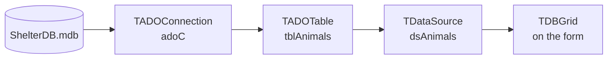

# Database Programming with TADOTable

::: info 📌 Key Points
- In Grade 11 you work with a database **through Delphi code**, not SQL. You move through the table one record at a time with `First`, `Next` and `Eof`.
- Read and write fields with **bracket notation**: `tblAnimals['AnimalName']`.
- To change data: `Insert` (new record) or `Edit` (existing record) → assign the fields → `Post`.
- Searching and counting are done **from first principles**: a loop, an `if`, a counter or a Boolean flag.
:::

A shelter keeps the details of 30 animals in an Access database. The manager asks: *"Which animals have not been adopted yet? How many cats still need to be sterilised? Is Luna still here?"* You could open Access and look, but a program can answer all three questions with a single click. All it needs to do is walk through the table, one record at a time, and test each record.

---

## See it working

The table **tblAnimals** in **ShelterDB.mdb**:

| AnimalID | AnimalName | Species | AgeMonths | Sterilised | Adopted |
|---|---|---|---|---|---|
| 1 | Bruno | Dog | 62 | True | False |
| 2 | Luna | Cat | 18 | True | False |
| 3 | Max | Dog | 30 | True | True |
| 4 | Coco | Rabbit | 9 | False | False |

This button displays every animal that has **not** been adopted:

```pascal
procedure TfrmQuestion3.btnAvailableClick(Sender: TObject);
begin
  redOutput.Clear;
  redOutput.Lines.Add('Name' + #9 + 'Species' + #9 + 'Age (months)');
  tblAnimals.First;                          // 1. go to the first record
  while not tblAnimals.Eof do                // 2. until we pass the last record
  begin
    if not tblAnimals['Adopted'] then        // 3. test the current record
      redOutput.Lines.Add(tblAnimals['AnimalName'] + #9 + tblAnimals['Species'] +
        #9 + IntToStr(tblAnimals['AgeMonths']));
    tblAnimals.Next;                         // 4. move to the next record
  end;
end;
```

```text
Name      Species   Age (months)
Bruno     Dog       62
Luna      Cat       18
Coco      Rabbit    9
```

---

## Understand it — the record pointer

A `TADOTable` always points at **one record**: the *current record*. Everything you read or write applies to that record only.

```text
            tblAnimals
   ┌──────────────────────────────┐
   │ 1  Bruno   Dog     ...       │ ◄── First puts the pointer here
   │ 2  Luna    Cat     ...       │ ◄── Next moves it down one record
   │ 3  Max     Dog     ...       │
   │ 4  Coco    Rabbit  ...       │
   └──────────────────────────────┘
     (after the last record)        ◄── Eof becomes True
```

| Method / property | What it does |
|---|---|
| `tblX.First` | Moves to the first record |
| `tblX.Next` | Moves to the next record |
| `tblX.Eof` | `True` once the pointer has moved past the last record |
| `tblX.RecordCount` | Number of records in the table |
| `tblX['FieldName']` | Reads (or writes) a field of the current record |

::: danger 🚨 Watch Out For
1. **Forgetting `Next`** creates an endless loop because the pointer never moves. Delphi freezes.
2. **Forgetting `First`** means the loop starts wherever the pointer was left by a previous button, so you may get no output at all.
3. **Misspelling a field name** (`tblAnimals['Name']` instead of `['AnimalName']`) causes a runtime error: *Field not found*.
:::

---

## How the connection is set up

In exams and PATs the connection code is usually **given** in a data module. You need to recognise it, not memorise it.

```pascal
// ConnectDB_U.pas — provided code
adoC.ConnectionString := 'Provider=Microsoft.Jet.OLEDB.4.0; ' +
  'Data Source=ShelterDB.mdb; Persist Security Info=False';
adoC.LoginPrompt := False;
adoC.Connected := True;

tblAnimals.Connection := adoC;
tblAnimals.TableName := 'tblAnimals';
tblAnimals.Active := True;
dsAnimals.DataSet := tblAnimals;       // the DBGrid shows dsAnimals
```



::: tip 💡 Why This Matters
Every app you use, from a banking app to Takealot to your school's admin system, sits on top of a database. The loop *"go to the first record, test it, move to the next"* is the same idea those systems use, just hidden behind SQL. Once you understand the record pointer, Grade 12 SQL makes a lot more sense.
:::

---

## Reading fields — bracket notation

```pascal
sName := tblAnimals['AnimalName'];                  // Short Text  → String
iAge  := tblAnimals['AgeMonths'];                   // Number      → Integer
bDone := tblAnimals['Adopted'];                     // Yes/No      → Boolean
dDate := tblAnimals['DateArrived'];                 // Date/Time   → TDateTime
rFee  := tblAnimals['Fee'];                         // Currency    → Real

redOutput.Lines.Add(tblAnimals['AnimalName']);       // a text field can be added directly
redOutput.Lines.Add(IntToStr(tblAnimals['AgeMonths']));            // numbers must be converted
redOutput.Lines.Add(FormatDateTime('dd/mm/yyyy', tblAnimals['DateArrived']));
```

::: warning ⚠️ Common Misconception
Learners often think that `tblAnimals['AgeMonths']` is a string because it comes "from the table". The field has the **data type of the database field**, so it is a number. Use `IntToStr`/`FloatToStrF` to display it and compare it directly with numbers: `if tblAnimals['AgeMonths'] > 6 then`.
:::

---

## Changing data

All three operations follow the same shape: **put the table in a mode → assign fields → `Post`**.

### Add a new record — `Insert` (or `Append`)

```pascal
tblAnimals.Insert;                            // a new, empty record
tblAnimals['AnimalName']  := 'Biscuit';
tblAnimals['Species']     := 'Dog';
tblAnimals['AgeMonths']   := 7;
tblAnimals['DateArrived'] := Date;            // today's date
tblAnimals['Sterilised']  := False;
tblAnimals['Adopted']     := False;
tblAnimals.Post;                              // save it
ShowMessage('Biscuit has been added');
```

::: info 📝 AutoNumber fields
Never assign a value to an **AutoNumber** primary key (e.g. `AnimalID`). Access generates it when you `Post`.
:::

### Change existing records — `Edit`

Loop through the table and edit only the records that meet a condition:

```pascal
iCount := 0;
tblAnimals.First;
while not tblAnimals.Eof do
begin
  if (tblAnimals['Species'] = 'Cat') and (tblAnimals['AgeMonths'] > 6) and
     (not tblAnimals['Sterilised']) then
  begin
    tblAnimals.Edit;                          // 1. edit mode
    tblAnimals['Sterilised'] := True;         // 2. change the field
    tblAnimals.Post;                          // 3. save
    Inc(iCount);
  end;
  tblAnimals.Next;
end;
redOutput.Lines.Add('Number of cats sterilised: ' + IntToStr(iCount));
```

### Remove a record — `Delete`

```pascal
tblAnimals.First;
while not tblAnimals.Eof do
begin
  if tblAnimals['AnimalID'] = 15 then
    tblAnimals.Delete                         // pointer moves to the next record automatically
  else
    tblAnimals.Next;
end;
```

::: danger 🚨 Watch Out For
After `Delete`, the **next** record becomes the current record. If you also call `Next`, you skip a record. That is why `Next` is in the `else`.
:::

---

## Searching — the Boolean flag pattern

Built-in shortcuts like `Locate` are **not** accepted when a question says *"from first principles"*. Use a flag that stops the loop as soon as the record is found:

```pascal
sSearch := InputBox('Search', 'Enter the name of the animal:', '');
bFound := False;
tblAnimals.First;
while (not tblAnimals.Eof) and (not bFound) do
begin
  if UpperCase(tblAnimals['AnimalName']) = UpperCase(sSearch) then
  begin
    bFound := True;                           // stop the loop, stay on this record
    redOutput.Lines.Add('Species: ' + tblAnimals['Species']);
    redOutput.Lines.Add('Arrived: ' + FormatDateTime('dd mmmm yyyy', tblAnimals['DateArrived']));
  end
  else
    tblAnimals.Next;
end;
if not bFound then
  redOutput.Lines.Add(sSearch + ' was not found');
```

Making **both sides** uppercase makes the search *case-insensitive*, so "luna", "LUNA" and "Luna" all match.

---

## Counting, totals and averages

```pascal
iCount := 0;
iTotal := 0;
tblAnimals.First;
while not tblAnimals.Eof do
begin
  if tblAnimals['Species'] = 'Dog' then
  begin
    Inc(iCount);
    iTotal := iTotal + tblAnimals['AgeMonths'];
  end;
  tblAnimals.Next;
end;
if iCount > 0 then
  redOutput.Lines.Add('Average age: ' + FloatToStrF(iTotal / iCount, ffFixed, 6, 1) + ' months');
```

### Grouping with an outer loop

To report on **every** species, put the table loop *inside* a loop over the groups. Go back to `First` and reset the counters for each group:

```pascal
for I := 1 to 3 do                            // arrSpecies = ('Dog', 'Cat', 'Rabbit')
begin
  iCount := 0;
  tblAnimals.First;                           // start at the top for EACH species
  while not tblAnimals.Eof do
  begin
    if tblAnimals['Species'] = arrSpecies[I] then
      Inc(iCount);
    tblAnimals.Next;
  end;
  redOutput.Lines.Add(arrSpecies[I] + ': ' + IntToStr(iCount));
end;
```

### Finding the maximum

```pascal
iMaxDays := -1;
tblAnimals.First;
while not tblAnimals.Eof do
begin
  if not tblAnimals['Adopted'] then
  begin
    iDays := Trunc(Date - tblAnimals['DateArrived']);   // days at the shelter
    if iDays > iMaxDays then
    begin
      iMaxDays := iDays;
      sLongest := tblAnimals['AnimalName'];
    end;
  end;
  tblAnimals.Next;
end;
```

---

## 📋 Summary

| Task | Pattern |
|---|---|
| Visit every record | `First` → `while not Eof` → … → `Next` |
| Read a field | `tblX['FieldName']` (convert numbers/dates to display them) |
| Add a record | `Insert` → assign fields → `Post` |
| Change a record | `Edit` → assign fields → `Post` (inside the loop, inside an `if`) |
| Delete a record | `Delete` — and **don't** call `Next` for that record |
| Search | Boolean flag; loop `while (not Eof) and (not bFound)` |
| Group report | Outer loop over the groups; `First` and reset counters inside it |

::: tip 🎯 Exam Tip
Marks are given for the **loop structure** (`First`, `while not Eof`, `Next`) on almost every database question, and that is separate from the logic inside the loop. Write those three lines first, even if you are unsure of the condition. Always click **Restore DB** before testing again, because your earlier test runs changed the data.
:::

## ✏️ Check Your Understanding

**Question 1:** A learner's loop never ends and the program freezes. Which line is most likely missing?

**Question 2:** Explain why `tblAnimals.Next` is placed in the `else` part when deleting records.

**Question 3:** Write the code to increase `AgeMonths` by 1 for every animal in the table. (5)

::: details Check your answers
**Q1:** `tblAnimals.Next;` Without it, the record pointer never moves, so `Eof` never becomes True.

**Q2:** `Delete` already moves the pointer to the next record. Calling `Next` as well would skip the record straight after the deleted one.

**Q3:**
```pascal
tblAnimals.First;                                          // ✓
while not tblAnimals.Eof do                                // ✓
begin
  tblAnimals.Edit;                                         // ✓
  tblAnimals['AgeMonths'] := tblAnimals['AgeMonths'] + 1;  // ✓
  tblAnimals.Post;
  tblAnimals.Next;                                         // ✓
end;
```
:::

---

*Previous: [← Text Files](./text-files) | Next: [Date & Time →](./date-time)*
