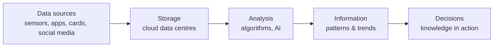

# Big Data, Digitalisation, Globalisation and 4IR

::: info 📌 Key Points
- **Big data** means data sets so large and fast-changing that ordinary software can't process them. They are described by the **Vs: Volume, Velocity, Variety** (plus Veracity and Value).
- **Digitalisation** means changing paper-based, manual processes into digital ones.
- **Globalisation** means the world becoming one connected economy and society, mostly through ICT.
- The **Fourth Industrial Revolution (4IR)** joins the physical, digital and biological worlds: AI, IoT, robotics, cloud and big data. It creates new jobs, replaces others and raises new ethical questions.
:::

Every time you scroll TikTok, tap your card at Checkers or ask your phone for directions, data is recorded. Millions of South Africans do the same every minute. Companies now use this data to predict what you will buy, when you will get sick, or which learners are likely to fail a subject. That power is useful, but it is also risky.

---

## Big data

**Big data** is a collection of data so large, so fast-growing and so varied that traditional databases and software cannot store or analyse it efficiently. It is analysed to find **patterns, trends and relationships**.

| V | Meaning | Example |
|---|---|---|
| **Volume** | Huge amounts of data (terabytes to petabytes) | All the card transactions of a national retailer |
| **Velocity** | Data arrives very fast, often in real time | GPS positions of thousands of taxis every few seconds |
| **Variety** | Many types: text, images, video, sensor readings | Social media posts, photos, CCTV, smart-meter data |
| *Veracity* | How accurate and trustworthy the data is | Fake reviews and bots reduce veracity |
| *Value* | The useful insight the data provides | Predicting which products to stock before winter |

### Uses and social implications

| Positive | Negative |
|---|---|
| Better decisions in business, health and education | Loss of **privacy**, because data is collected without people realising |
| Predicting disease outbreaks or traffic congestion | **Profiling** and discrimination (e.g. insurance or loan decisions) |
| Personalised services and recommendations | Data breaches expose millions of records at once |
| Detecting fraud quickly | "Filter bubbles" — you only see content that matches your views |

::: info 🇿🇦 SA Context
**POPIA** limits how South African organisations may collect and use personal information. Even big-data analysis must have a lawful purpose, be secured, and not keep personal data longer than needed.
:::

---

## Digitalisation

**Digitalisation** is using digital technology to change how an organisation works, for example moving from paper files and manual processes to online systems.

| Advantages | Disadvantages / risks |
|---|---|
| Faster to search, share and process information | Cost of equipment, software and training |
| Less paper and physical storage | Dependence on electricity and connectivity (load shedding!) |
| Data can be backed up and analysed | Cybercrime and data breaches |
| Services available 24/7 online | People without devices/data are excluded (**digital divide**) |

---

## Globalisation

**Globalisation** is the process by which people, businesses and countries become **interconnected and interdependent** through trade, communication and technology.

ICT drives globalisation through:
- e-commerce: buying from shops in other countries
- cloud platforms and remote work: a South African developer working for a company in Germany
- social media and video calling: instant communication anywhere
- global supply chains tracked in real time

| Positive | Negative |
|---|---|
| Access to global markets, products and knowledge | Local businesses compete with global giants |
| Remote work and freelancing opportunities | Jobs move to countries with cheaper labour |
| Cultural exchange and collaboration | Loss of local culture and languages |

---

## The Fourth Industrial Revolution (4IR)

| Revolution | Driver |
|---|---|
| 1st | Steam power and mechanisation |
| 2nd | Electricity and mass production |
| 3rd | Computers, electronics and the Internet |
| **4th** | **Cyber-physical systems:** AI, IoT, robotics, big data, cloud, 3D printing, blockchain |

### Impact on work

| Jobs at risk (routine, repetitive) | New / growing jobs |
|---|---|
| Data capturers, bank tellers, call-centre agents | Data analysts and data scientists |
| Assembly-line workers | AI / machine-learning engineers |
| Cashiers | Cybersecurity specialists |
| Manual record keepers | IoT technicians, drone operators, social media managers |

::: info 🇿🇦 SA Context
South Africa's **Presidential Commission on the Fourth Industrial Revolution** (report gazetted in 2020) recommended investing in human capital (skills such as coding, data science and AI), building digital infrastructure, and setting up an AI institute. The aim is for South Africans to benefit from 4IR rather than be left behind by it.
:::

::: tip 💡 Why This Matters
Many of the jobs you will apply for in 10 years don't exist yet. The skills that 4IR rewards are exactly the ones you practise in IT: problem-solving, programming and working with data.
:::

---

## Human error vs computer error

When a system produces wrong information, the cause is either **human** or **computer** error.

| Human error | Computer error |
|---|---|
| Wrong data captured (typing 1000 instead of 100) | Software bugs (logic errors in the program) |
| Data not verified or validated | Hardware failure (faulty RAM, disk crash) |
| Poor instructions or untrained users | Corrupted data / data loss during transmission |
| Ignoring warnings / incorrect use | Incorrect AI / algorithm output (e.g. biased training data) |

**GIGO — Garbage In, Garbage Out:** even a perfect program gives wrong answers if it receives wrong data. Most "computer errors" are really human errors: either in the data or in the code a person wrote.

**Reducing errors:** validation and verification of input, proper testing of software, user training, backups, and human checking of automated decisions.

::: warning ⚠️ Common Misconception
"The computer made a mistake." Computers do exactly what they are programmed to do with the data they are given. When AI gives a wrong result, the cause is usually incomplete or biased **training data**, or a design decision that a human made.
:::

---

## 📋 Summary

| Concept | Key point |
|---|---|
| Big data | Volume, Velocity, Variety (+ Veracity, Value); analysed for patterns |
| Digitalisation | Manual/paper processes become digital |
| Globalisation | World becomes interconnected through ICT and trade |
| 4IR | AI, IoT, robotics, big data; jobs change, ethical questions grow |
| Errors | Human (input, use) vs computer (bugs, hardware); GIGO |

::: tip 🎯 Exam Tip
Section F questions on these topics are usually **"discuss"** or **"evaluate"** questions worth 2–3 marks. Give **one point per mark** and always link it to the scenario in the question. A general definition alone earns only one mark.
:::

## ✏️ Check Your Understanding

**Question 1:** Name and explain the THREE Vs of big data. (3)

**Question 2:** A municipality digitalises its water-meter readings. Give ONE advantage and ONE risk. (2)

**Question 3:** A shelter's AI app matched a lost dog with the wrong owner. Is this human or computer error? Motivate. (2)

::: details Check your answers
**Q1:** Volume, a very large amount of data ✓. Velocity, data is generated and processed very fast/in real time ✓. Variety, many different types/formats of data ✓.

**Q2:** Advantage, e.g. faster and more accurate billing / leaks detected early ✓. Risk, e.g. hacking of the system / no readings during outages / cost ✓.

**Q3:** Either, if motivated ✓✓. Computer error: the algorithm gave an incorrect match. Human error: a poor photo was uploaded, or staff accepted the match without checking the microchip.
:::

---

*Previous: [← Privacy & Ethics](./privacy-ethics) | Next: [Digital Divide →](./digital-divide)*

**Sources:** [Presidential Commission on 4IR report – Michalsons summary](https://www.michalsons.com/blog/report-of-the-presidential-commission-on-the-4th-industrial-revolution-pc4ir/45956) · [SAnews: 4IR Commission recommendations gazetted](https://www.sanews.gov.za/node/49319)
